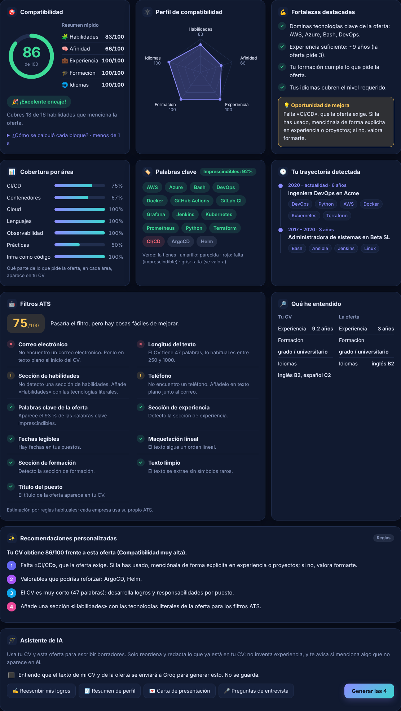
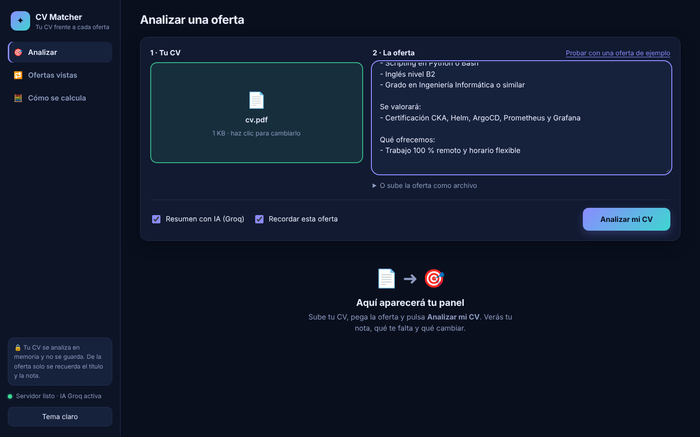
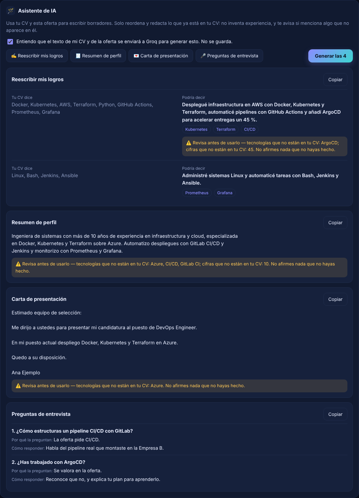

# CV Matcher

[](../../actions/workflows/ci.yml)


Analiza un CV (PDF, DOCX o TXT) y lo compara con una oferta de empleo, en español o en inglés. Devuelve una
**nota de compatibilidad de 0 a 100 explicada por bloques**, las habilidades que cubres y las que te faltan,
una revisión de **filtros ATS** y consejos concretos para mejorar el CV.



> Capturas con un CV y una oferta de ejemplo ficticios.

## Qué incluye

- **API REST** (FastAPI) en `/api/v1/*`, con documentación interactiva en `/docs`.
- **Interfaz web** en `/app` (HTML, CSS y JS propios, sin dependencias externas): panel oscuro (con variante clara) y
  adaptado a móvil, con la nota en un anillo, radar de compatibilidad, fortalezas, cobertura por área, palabras
  clave, trayectoria detectada, filtros ATS y recomendaciones.
- **Filtros ATS**: nota propia y comprobaciones de contacto, secciones estándar, fechas, longitud, símbolos raros,
  columnas, palabras clave de la oferta y título del puesto. Es una estimación por reglas, no la simulación de un
  ATS concreto.
- **Historial de ofertas vistas**: avisa si analizas una oferta que ya viste, o una casi idéntica republicada.
- **IA opcional con [Groq](https://console.groq.com)** (tiene capa gratuita):
  - resumen y recomendaciones del análisis (solo recibe datos estructurados);
  - **Asistente de IA**: reescribe tus logros para la oferta, resumen de perfil, carta de presentación y preguntas de
    entrevista. Estas funciones sí envían el texto del CV y de la oferta, por eso piden consentimiento (ver
    [Seguridad y privacidad](#seguridad-y-privacidad)).
- Sin clave de Groq todo lo demás funciona igual, con consejos basados en reglas.

También existe una **versión web independiente** que corre solo en el navegador, sin servidor, en su propio
repositorio: `cv-matcher-web`.

| Formulario | Asistente de IA |
|---|---|
|  |  |

## Cómo calcula la nota

`nota = Σ peso_i · nota_i` (notas de 0 a 100). Los pesos se normalizan entre los bloques que aplican: si la oferta
no pide idiomas, ese bloque no puntúa y su peso se reparte entre los demás.

| Bloque | Peso | Cómo se calcula |
|---|---|---|
| Habilidades técnicas | 45 % | Diccionario de 150+ tecnologías (`data/skills/skills_db.json`). 80 % imprescindibles y 20 % valorables ("Se valorará…"). Tecnologías de la misma familia (AWS↔Azure) dan el 50 %; "AWS o Azure" cubre ambas si tienes una. |
| Afinidad del contenido | 20 % | Similitud entre los textos (TF-IDF por defecto; embeddings multilingües opcionales), calibrada a 0-1. |
| Experiencia | 15 % | Años del CV (rangos de fechas fusionados y "N años de experiencia") entre los años que pide la oferta. |
| Formación | 10 % | Nivel (FP < grado < máster < doctorado) frente al mínimo que pide la oferta. |
| Idiomas | 10 % | Nivel (A1-C2) frente al requerido, por idioma. |

Cada respuesta incluye el desglose, las notas explicativas y los pesos efectivos. Los pesos se cambian en `.env`.

## Requisitos

- Python **3.12**
- (Opcional) clave de Groq: <https://console.groq.com/keys>
- (Opcional) Docker

## Instalación

```bash
python -m venv .venv
source .venv/bin/activate          # Windows (PowerShell): .venv\Scripts\Activate.ps1
pip install -r requirements.txt    # desarrollo: pip install -r requirements-dev.txt
cp .env.example .env               # Windows: copy .env.example .env
```

Embeddings semánticos multilingües (opcional, ~2 GB por torch):

```bash
pip install -r requirements-ml.txt
python scripts/download_models.py
# y en .env: EMBEDDING_BACKEND=sentence-transformers
```

## Ejecutar

```bash
python main.py                      # http://127.0.0.1:8000  (interfaz en /app/, API en /docs)
uvicorn main:app --reload           # modo desarrollo
```

Con Docker:

```bash
cp .env.example .env
docker compose up --build
```

Para activar la IA, pon tu clave en `.env` (`GROQ_API_KEY=...`) y reinicia.

## Variables de entorno

Todas están comentadas en [`.env.example`](.env.example). Las principales:

| Variable | Por defecto | Descripción |
|---|---|---|
| `GROQ_API_KEY` | vacío | Activa las funciones de IA. **Nunca la subas a git.** |
| `GROQ_MODEL` | `llama-3.3-70b-versatile` | Modelo de Groq. |
| `API_KEY` | vacío | Si se define, la API exige la cabecera `X-API-Key`. Obligatoria con `APP_ENV=production`. |
| `CORS_ORIGINS` | localhost | Orígenes permitidos, separados por comas. |
| `MAX_UPLOAD_MB` / `MAX_PDF_PAGES` | 5 / 15 | Límites de subida. |
| `RATE_LIMIT_PER_MINUTE` | 20 | Peticiones POST por IP y minuto (0 = sin límite). |
| `EMBEDDING_BACKEND` | `tfidf` | `tfidf` o `sentence-transformers`. |
| `ENABLE_UI` | `true` | Sirve la interfaz web en `/app`. |
| `ENABLE_GRADIO` | `false` | Interfaz antigua de Gradio en `/ui` (opcional; requiere `pip install gradio`). |
| `HISTORY_ENABLED` | `true` | Guarda las ofertas analizadas para avisar de repetidas. |
| `HISTORY_DB_PATH` | `data/processed/history.db` | Archivo SQLite del historial. |

## Uso de la API

```bash
curl -F "cv_file=@mi_cv.pdf" \
     -F "job_text=$(cat oferta.txt)" \
     -F "use_llm=true" \
     http://127.0.0.1:8000/api/v1/analyze
```

Con `API_KEY` definida, añade `-H "X-API-Key: <tu clave>"`. Respuesta (resumida):

```json
{
  "score": 81.2,
  "band_label": "Compatibilidad muy alta",
  "components": [{"key": "skills", "score": 100.0, "effective_weight": 0.45, "note": "12 de 14 requisitos cubiertos…"}],
  "skills": {"matched": ["Docker", "Kubernetes"], "missing_required": [], "missing_nice": ["Helm"], "partial": []},
  "ats": {"score": 80, "checks": [{"id": "email", "status": "ok", "label": "Correo electrónico", "detail": "…"}]},
  "advice": {"summary": "…", "recommendations": ["…"], "source": "rules"}
}
```

Si analizas de nuevo la misma oferta, la respuesta trae `seen_before` con la fecha, las veces y la nota anterior
(`"exact": false` indica una oferta muy parecida, no idéntica). Con `remember_job=false` no se registra.

| Método | Ruta | Descripción |
|---|---|---|
| POST | `/api/v1/analyze` | `cv_file` + (`job_text` o `job_file`) + `use_llm` → nota, ATS y consejos |
| POST | `/api/v1/assist` | Asistente de IA (`rewrite`, `summary`, `cover`, `interview`); exige `consent=true` |
| POST | `/api/v1/cv/extract` | Perfil extraído de un CV (habilidades, años, estudios, idiomas) |
| GET | `/api/v1/skills?q=` | Consulta el diccionario de habilidades |
| GET | `/api/v1/history` | Ofertas ya analizadas (título, nota, veces, fechas) |
| DELETE | `/api/v1/history/{id}` · `/api/v1/history` | Olvida una oferta · vacía el historial |
| GET | `/health` | Estado del servicio |

Errores: siempre `{"error": {"code", "message", "request_id"}}` con el código HTTP adecuado (400 vacío o sin
consentimiento, 401 clave, 413 tamaño, 415 tipo de archivo, 422 datos no válidos o PDF sin texto o cifrado, 429
límite de peticiones, 503 IA no configurada).

## Tests

```bash
pip install -r requirements-dev.txt
pytest
ruff check --config ruff.toml .
```

Los tests no usan red ni claves (Groq se simula) y generan sus propios PDF y DOCX en memoria. La integración
continua de GitHub (`.github/workflows/ci.yml`) ejecuta lo mismo en cada push.

## Seguridad y privacidad

- **Los CVs no se guardan**: se procesan en memoria y se descartan al terminar la petición. (Starlette puede usar un
  archivo temporal del sistema para subidas grandes; se borra al cerrar la petición. Con Docker el sistema de
  archivos es de solo lectura salvo `/tmp`.)
- **Historial de ofertas**: es lo único que se guarda (SQLite local en `data/processed/`, ignorado por git): huella
  de la oferta, su título, la nota y las fechas. Nunca el CV ni el cuerpo de la oferta. Se puede vaciar desde la
  interfaz o con `DELETE /api/v1/history`, y desactivar con `HISTORY_ENABLED=false`.
- **Los logs no contienen datos del CV ni de la oferta**, solo metadatos (tamaños, tiempos, nota).
- **Qué se envía a Groq (un tercero):**
  - El resumen del análisis solo recibe datos estructurados (notas y nombres de tecnologías), nunca el texto del CV.
  - El **Asistente de IA sí envía el texto del CV y de la oferta**. Por eso la API exige `consent=true` en cada
    petición y la interfaz pide marcar una casilla. Si usas la app con CVs de otras personas, infórmales y revisa las
    condiciones de Groq.
- **Contra las invenciones de la IA**: los prompts prohíben inventar y tratan el CV y la oferta como datos, no como
  instrucciones; se descartan las viñetas "originales" que no estén en el CV; y cada resultado avisa de cifras o
  tecnologías que no aparecen en él. Revisa siempre los borradores.
- Validación de archivos por **contenido real** (no solo extensión), tamaño, páginas, PDF cifrado y DOCX "zip bomb".
- CORS restringido, límite de peticiones por IP, cabeceras de seguridad y errores 500 sin detalles internos.
- La interfaz `/app` es pública; si defines `API_KEY`, pide la clave en pantalla y la envía en `X-API-Key`. Se sirve
  con una CSP estricta (solo recursos propios). Tras un proxy inverso, el límite por IP verá la IP del proxy.

Más detalles en [SECURITY.md](SECURITY.md).

## Estructura

```
app/            API FastAPI (api.py, schemas.py) y UI web en app/static/ (Gradio opcional)
src/
  config/         configuración desde variables de entorno
  ingestion/      carga y validación de PDF/DOCX/TXT
  preprocessing/  limpieza y detección de secciones
  nlp/            habilidades, experiencia, formación e idiomas
  embeddings/     similitud semántica (TF-IDF / sentence-transformers)
  matching/       nota explicable, consejos por reglas y filtros ATS
  llm/            cliente Groq, asesor y asistente (con fallback a reglas)
  history/        historial de ofertas vistas (SQLite + MinHash para detectar parecidas)
  pipeline/       flujo completo
data/skills/skills_db.json   diccionario (se regenera con scripts/build_skills_db.py)
docs/screenshots/            capturas del README
tests/                       pruebas con pytest
```

Añadir una tecnología: edita `SEED` en `scripts/build_skills_db.py` y ejecuta `python scripts/build_skills_db.py`.

## Limitaciones conocidas

- Solo detecta lo que está en el diccionario de habilidades; una tecnología nueva no se reconocerá hasta añadirla.
- No hay OCR: los PDF escaneados (imágenes) se rechazan con un mensaje claro.
- Los años de experiencia dependen de que el CV tenga fechas legibles (`ene 2018 - actualidad`, `2015 - 2020`).
- El nivel de idioma y de estudios se extrae con reglas y puede fallar con redacciones muy poco habituales.
- Los filtros ATS son una estimación: cada empresa usa su propio sistema.

## Licencia

[MIT](LICENSE).
